# PC System Fundamentals, Disk Sectors and Partition Analysis

**Course:** CIP-B101 | Basic Computer Skills for Digital Forensics
**Institution:** International Cybersecurity and Digital Forensics Academy (ICDFA) | SHESEC Initiative

> All examinations in this report were performed using read-only methods. No partition was formatted, deleted, resized or modified.

## Contents

- [Part A - System Identification and Evidence Layer Mapping](#part-a---system-identification-and-evidence-layer-mapping)
- [Part B - Program, Process and Thread Investigation](#part-b---program-process-and-thread-investigation)
- [Part C - Disk Sector and Disk Size Calculation](#part-c---disk-sector-and-disk-size-calculation)
- [Part D - Safe Partition Table Inspection](#part-d---safe-partition-table-inspection)
- [Part E - MBR, GPT and Boot Process Explanation](#part-e---mbr-gpt-and-boot-process-explanation)
- [Part F - File System Identification and Interpretation](#part-f---file-system-identification-and-interpretation)
- [Part G - Final Practical Assignment](#part-g---final-practical-assignment)

---

## Part A - System Identification and Evidence Layer Mapping

In this section, I identify the major computer system layers and explain how each layer can produce forensic evidence.

### A1. Capture basic system specification

I opened System Information with `Windows + R`, typed `msinfo32` and pressed Enter. The purpose of this first step is to capture the system profile of the computer, such as OS name, version, processor and Secure Boot state.


*EVID_01: Systems Specification on Windows*

| Item | Value |
|------|-------|
| OS Name | Microsoft Windows 11 Pro |
| Version | 10.0.26300 Build 26300 |
| System Name | DESKTOP-SBPA495 |
| System Manufacturer / Model | HP EliteBook x360 1030 G3 |
| System Type | x64-based PC |
| Processor | Intel Core i7-8650U @ 1.90 GHz, 4 cores, 8 logical processors |
| BIOS Version/Date | HP Q90 Ver. 01.32.00, 12/03/2025 |
| BIOS Mode | UEFI |
| Secure Boot State | On |

EVID_02 captures the system information using PowerShell. Information such as IP address, server IP, the system details captured in EVID_01, MAC address and registered owner was collected from the command line interface of the operating system.

```powershell
systeminfo
```


*EVID_02: Systems Spec using PowerShell*

### A2. Capture storage information

On PowerShell, the system storage information, such as disk, partition and volume details, was captured.

```powershell
Get-Disk
Get-Partition
Get-Volume
```


*EVID_03: Storage Info, Disk, Volume and Partition*

---

## Part B - Program, Process and Thread Investigation

This section links the slide concepts of program, process and thread to forensic observation.

### B1. Observe running processes

```powershell
Get-Process | Select-Object -First 20 Name,Id,CPU,WorkingSet
```

The running processes are identified but listed in alphabetical order. CPU consumption is not prioritised from highest to lowest. Unlike the PowerShell output, Task Manager tends to sort processes from the highest to the lowest CPU consumption.


*EVID_04: Observe Running Process on PowerShell*

### B2. Explain the difference

A **program** is a set of instructions carried out by the operating system. These instructions come from applications, which can be legitimate or malicious, and they are stored on disk. There are also built-in programs that run in the background of an OS and contribute strongly to its functionality.

A **process** is a running instance of a program. When a program is launched, the computer loads it into memory and starts running it. The running program is called a process and it is located in RAM. If it is not collected in real time, it is lost when the system shuts down or reboots.

A **thread** is a single line of work inside a process. A process always has at least one thread, but it can have many, and each one can handle a different task at the same time.

Process information is useful during malware analysis and live forensic triage because it captures activity in real time. However, it is volatile and can be lost if it is not captured and stored on disk. Attackers can exploit this, because malicious activity cannot be retained if the system goes offline without the evidence being captured and stored.

---

## Part C - Disk Sector and Disk Size Calculation

### C1. Reproduce the slide calculation and calculate my own disk or partition size

```powershell
Get-Disk | Select Number,FriendlyName,PartitionStyle,LogicalSectorSize,PhysicalSectorSize
Get-Partition | Select DiskNumber,PartitionNumber,DriveLetter,Type,Offset,Size
```


*EVID_05: Get Partition*

### C2. My own partitions (Disk 0, sector size = 512 bytes)

All four partitions are calculated below.

**Formulas used**

```
Start sector      = Offset / 512
Number of sectors = Size / 512
Size in GB        = Number of sectors x 512 / 1024 / 1024 / 1024
```

#### Partition 1: EFI System partition (FAT32)

- Start sector = 1,048,576 / 512 = **2,048**
- Number of sectors = 104,857,600 / 512 = **204,800**
- Size in GB = 204,800 x 512 / 1024 / 1024 / 1024 = 104,857,600 / 1,073,741,824 = **0.098 GB** (about 100 MB)

#### Partition 2: Reserved / MSR (no file system)

- Start sector = 105,906,176 / 512 = **206,848**
- Number of sectors = 16,777,216 / 512 = **32,768**
- Size in GB = 32,768 x 512 / 1024 / 1024 / 1024 = 16,777,216 / 1,073,741,824 = **0.0156 GB** (16 MB)

#### Partition 3: C: drive (NTFS)

- Start sector = 122,683,392 / 512 = **239,616**
- Number of sectors = 510,604,083,200 / 512 = **997,273,600**
- Size in GB = 997,273,600 x 512 / 1024 / 1024 / 1024 = 510,604,083,200 / 1,073,741,824 = **475.54 GB**

#### Partition 4: Recovery (NTFS)

- Start sector = 510,726,766,592 / 512 = **997,513,216**
- Number of sectors = 1,380,974,592 / 512 = **2,697,216**
- Size in GB = 2,697,216 x 512 / 1024 / 1024 / 1024 = 1,380,974,592 / 1,073,741,824 = **1.29 GB**

| Partition | Type | Start sector | Sectors | Size |
|-----------|------|--------------|---------|------|
| 1 | System (EFI, FAT32) | 2,048 | 204,800 | 0.098 GB |
| 2 | Reserved (MSR) | 206,848 | 32,768 | 0.0156 GB |
| 3 | Basic (C:, NTFS) | 239,616 | 997,273,600 | 475.54 GB |
| 4 | Recovery (NTFS) | 997,513,216 | 2,697,216 | 1.29 GB |

---

## Part D - Safe Partition Table Inspection

This section inspects the disk and partition tables using read-only commands on both Windows and Linux.

### D1. Windows method: Disk Management, PowerShell and DiskPart

Two ways were used to view disks and partitions. The first was the graphical Disk Management tool. The second was an administrator PowerShell window, running the commands shown below. DiskPart was also used with listing commands only.


*EVID_06: Disk Management*


*EVID_06: Disk, Partition and Volume on PowerShell*

```
DiskPart
DISKPART> list disk
DISKPART> select disk 0
DISKPART> list partition
DISKPART> exit
```


*EVID_06: DiskPart and Partitions on PowerShell*

### D2. Linux/Kali method: read-only inspection

As with the Windows capture, this inspection was read-only. It was done on Kali Linux and shows the disk, partition, size and file system information.

```bash
lsblk -o NAME,SIZE,TYPE,FSTYPE,MOUNTPOINT
sudo fdisk -l
sudo parted -l
blkid
df -h
```


*EVID_08: Read only Inspection on Kali 1*


*EVID_08: Read only Inspection on Kali 2*

| Device | Size | Type | File system | Mount |
|--------|------|------|-------------|-------|
| /dev/sda1 | 23.7 GB | Primary (boot flag) | ext4 | / |
| /dev/sda2 | 1 KB | Extended | n/a | n/a |
| /dev/sda5 | 1.3 GB | Logical | swap | [SWAP] |

---

## Part E - MBR, GPT and Boot Process Explanation

This section explains the PC boot process and distinguishes MBR from GPT using evidence from my own disk.

### E1. Explain the boot process


*EVID_09: A Boot Process Flow Diagram using Draw.io*

```mermaid
flowchart LR
    A[Power On] -->|Power supply stabilises, CPU starts running| B[Power-On Self-Test POST]
    B -->|Firmware checks that the basics work| C[BIOS/UEFI firmware]
    C -->|Firmware takes over and sets up the hardware| D[Finds boot device]
    D --> E[Reads MBR or EFI Boot Record]
    E -->|Boot code and partition table| F[Boot manager / loader]
    F -->|Reads boot configuration, shows OS menu, starts OS loader| G[Kernel loads]
    G -->|Loads kernel, HAL and boot-time drivers into memory| H[OS takes control]
```



The evidence from the outputs I collected shows that my disk (Samsung MZVLB512HAJQ) uses a **GPT** partition style. Partition 1 is a **System partition, FAT32, about 100 MB**. This is the **EFI System Partition**, which only UEFI boot uses. Partition 2 is a **Reserved (MSR)** partition, which is standard on UEFI/GPT Windows installations.

By contrast, the Kali VM disk uses an **MBR (msdos)** partition table, as shown by `Disklabel type: dos` in the `fdisk -l` output.

---

## Part F - File System Identification and Interpretation

A file system is important in digital forensics because it determines how data, metadata, timestamps and deleted files are stored and recovered. I identified the file system used by at least two volumes or partitions on my system: on Windows, whether volumes use NTFS, FAT/FAT32, exFAT or another file system, and on Linux, whether partitions use ext4, XFS, btrfs, swap or another file system.

**Windows**

```powershell
Get-Volume
```


*EVID_09: File System Inspected on PowerShell*

**Linux (Kali)**

```bash
lsblk -f
blkid
df -Th
```


*EVID_10: A File System Inspected on Kali Linux*

| System | Volume / Partition | File system |
|--------|--------------------|-------------|
| Windows | EFI System Partition (100 MB) | FAT32 |
| Windows | C: (475.54 GB, BitLocker encrypted) | NTFS |
| Windows | Recovery (1.29 GB) | NTFS |
| Kali Linux | /dev/sda1 (mounted on /) | ext4 |
| Kali Linux | /dev/sda5 | swap |

---

## Part G - Final Practical Assignment

**Task:** Verify the size of partitions 1 and 2 of a PC using a partition table. Record the verification process step by step and calculate the size of each partition in GB, using partition table evidence.


*EVID_05: Get Partition*

### Partition 1

| Task | Required evidence | Student notes / answer |
|------|-------------------|------------------------|
| Identify partition 1 | <br>*EVID_11: Partition 1* | EFI System Partition, no drive letter. `Get-Volume` lists it as FAT32. |
| Record partition 1 sector count | Offset and Size from the table | Start sector = 1,048,576 / 512 = **2,048**. Sector count = 104,857,600 / 512 = **204,800**. End sector = 2,048 + 204,800 - 1 = **206,847**. |
| Calculate partition 1 size | Formula and result | 204,800 x 512 = 104,857,600 bytes. 104,857,600 / 1024 / 1024 / 1024 = **0.0977 GB** (100 MB). |

### Partition 2

| Task | Required evidence | Student notes / answer |
|------|-------------------|------------------------|
| Identify partition 2 | <br>*EVID_12: Partition 2* | Microsoft Reserved Partition (MSR), no drive letter, no file system. |
| Record partition 2 sector count | Offset and Size from the table | Start sector = 105,906,176 / 512 = **206,848**. Sector count = 16,777,216 / 512 = **32,768**. End sector = 206,848 + 32,768 - 1 = **239,615**. |
| Calculate partition 2 size | Formula and result | 32,768 x 512 = 16,777,216 bytes. 16,777,216 / 1024 / 1024 / 1024 = **0.0156 GB** (16 MB). |

### Comparison with OS-reported size

```powershell
powershell -command "Get-Volume | Select DriveLetter,FileSystem,FileSystemLabel,Size"
```


*EVID_13: Compared to OS Reporting Size*

- **Partition 1:** `Get-Volume` reports 100,663,296 bytes = 0.0938 GB, against my calculated 104,857,600 bytes = 0.0977 GB.
- **Partition 2:** `Get-Volume` does not list it because it has no file system, so the OS-reported size is the `Get-Partition` value of 16,777,216 bytes, which matches my calculation exactly.

### Explanation of differences

- **Partition 1:** 104,857,600 - 100,663,296 = 4,194,304 bytes, which is exactly 4 MiB. The FAT32 file system uses part of the partition for its own structures (boot sector, reserved sectors, FAT tables), so the volume size is slightly smaller than the raw partition size.
- **Partition 2:** There is no difference. With no file system there is no overhead, so the partition table size is the full size.
- **GB vs GiB:** I divided by 1024 three times, which gives binary gigabytes (GiB). Dividing by 1000 instead would give 0.105 GB and 0.0168 GB. The byte counts are identical; only the convention differs.
- **Consistency check:** Partition 1 ends at sector 206,847 and partition 2 starts at 206,848. Partition 2 ends at 239,615 and the C: partition starts at 239,616 (122,683,392 / 512). There are no gaps or overlaps, so the partition table is intact.

---

## Conclusion

The examination confirmed that the system uses a GPT-partitioned disk booted through UEFI, with four partitions: an EFI System Partition, a Microsoft Reserved partition, the NTFS C: drive and an NTFS recovery partition. Partition sizes calculated from the sector information in the partition table matched the operating system's own figures, with the only difference being the 4 MiB FAT32 overhead on partition 1. All evidence was gathered using read-only methods.
